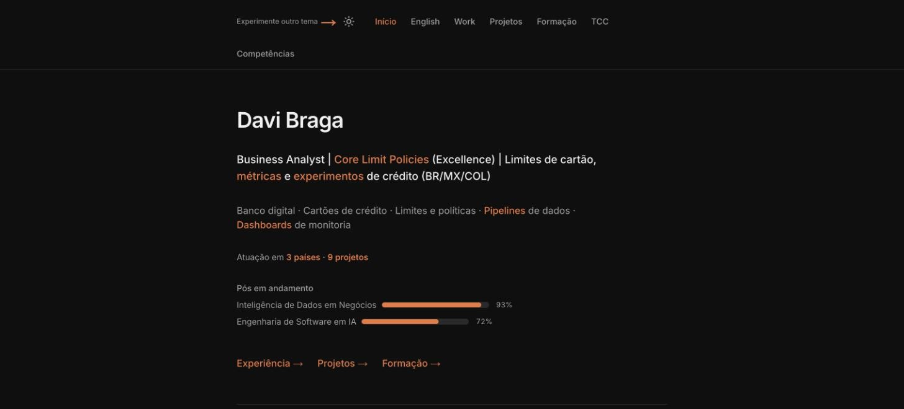

# meu-portfolio

Davi Braga's personal résumé site: experience, education, thesis and skills in a statically generated Next.js app.

[](https://davi-braga-portfolio.vercel.app)

**[Live demo: davi-braga-portfolio.vercel.app](https://davi-braga-portfolio.vercel.app)** (the site is mostly in Portuguese, with a full English profile at `/en`)

[](https://davi-braga-portfolio.vercel.app)
[](LICENSE)


## What it is

meu-portfolio is the source code of Davi Braga's personal résumé site. It presents his work experience (Nubank and earlier roles), projects, education (including full programme pages for two postgraduate courses), his undergraduate thesis and a skills map. The content is mostly in Portuguese, with a full English profile page and bilingual skill labels. It is a Next.js App Router project where most of the content is typed data in `src/data` and every page is prerendered at build time.

## Highlights

- **Nine static pages.** Home, English profile, work experience, projects, education (plus two programme pages), thesis and skills; `next build` prerenders every route as static content.
- **Three themes.** Dark, light and a "terminal" theme, switched from the menu bar. The choice is stored in `localStorage` and applied by an inline script before hydration; without a saved choice the site follows the system colour scheme.
- **Splash screen.** A welcome screen with a fireworks animation and skill tags appears once per browser session on the home page (a reload or `?intro=1` shows it again).
- **Bilingual content.** Portuguese pages, a full English profile at `/en`, and every skill listed in both languages.
- **Small details.** A scroll-progress bar, a back-to-top button, tag tooltips with short explanations, progress bars for ongoing programmes computed from their start and end dates, and a hidden keyboard easter egg.
- **Security headers.** `next.config.js` sends `nosniff`, `X-Frame-Options: DENY`, `frame-ancestors 'none'`, a referrer policy and a permissions policy on every route.

## How it works

Each route in `src/app` is a React Server Component that imports typed content from `src/data` (experience, education, skills, projects, thesis and programme syllabi) and renders it through small presentational components such as cards, tag tooltips and accordions. The interactive pieces (`"use client"`: theme toggle, splash screen, scroll progress, back-to-top button, easter egg) are mounted once in the root layout. Styling is Tailwind CSS 4 plus one set of CSS variables per theme in `globals.css`. `next build` prerenders everything to static HTML, which Vercel serves. `next.config.js` adds the security headers and a permanent redirect from `/about` to `/`.

## Tech stack

- **Framework:** Next.js 16 (App Router, Turbopack) and React 18
- **Language:** TypeScript 5 (strict mode)
- **Styling:** Tailwind CSS 4 (`@tailwindcss/postcss`) with CSS variables for the themes
- **Fonts:** Inter through `next/font/google`
- **Quality:** ESLint 9 with `eslint-config-next`
- **Hosting:** Vercel

## Run locally

Requires Node.js 20.9 or newer (a Next.js 16 requirement). No environment variables are needed.

```bash
git clone https://github.com/DaviBragaBA/meu-portfolio.git
cd meu-portfolio
npm install
npm run dev
```

The dev server runs at <http://localhost:3000>. Other scripts from `package.json`:

| Command | What it does |
| --- | --- |
| `npm run build` | Creates the production build |
| `npm run start` | Serves the production build |
| `npm run lint` | Runs ESLint |

Optionally, set `NEXT_PUBLIC_SITE_URL` to the public URL of your deployment; it is used as the base for link-preview metadata.

## Project structure

```text
meu-portfolio/
├── docs/                    screenshot used in this README
├── public/fotos/            photos used by the home page
├── src/
│   ├── app/                 App Router pages and the root layout
│   │   ├── page.tsx         home
│   │   ├── en/              English profile
│   │   ├── projects/        work experience ("Work" in the menu)
│   │   ├── projetos/        work projects and personal study guides
│   │   ├── formation/       education, with pos/ and pos-ia/ programme pages
│   │   ├── tcc/             undergraduate thesis
│   │   ├── skills/          skills in Portuguese and English
│   │   ├── layout.tsx       font, metadata, menu, footer and global effects
│   │   └── globals.css      Tailwind CSS 4 import and the theme variables
│   ├── components/          cards, menu, theme toggle, splash screen, effects
│   └── data/                typed content: experience, education, skills, projects, thesis, syllabi
├── next.config.js           security headers and the /about redirect
├── eslint.config.mjs        ESLint 9 flat config
├── linkedin_profile_en.md   English profile texts
├── professional_profile_en.md
└── SECURITY.md, CONTRIBUTING.md, AGENTS.md, LICENSE
```

## Author

**Davi Braga**, Business Analyst at Nubank · Software engineer in applied AI

- Portfolio: [davi-braga-portfolio.vercel.app](https://davi-braga-portfolio.vercel.app)
- GitHub: [@DaviBragaBA](https://github.com/DaviBragaBA)

## License

[MIT](LICENSE) © 2026 Davi Braga
